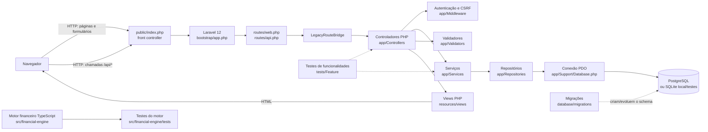
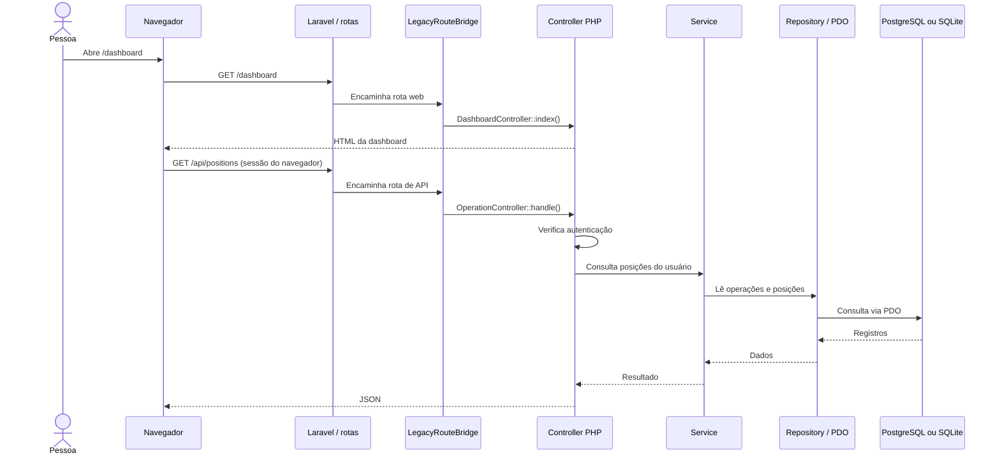

# Diagrama de arquitetura

Este diagrama representa o fluxo observado no checkout atual. As rotas Laravel encaminham as requisições para os controladores PHP existentes por meio de `LegacyRouteBridge`; o acesso aos dados de negócio continua passando pelos serviços e repositórios PDO.

## Visão geral

## Fluxo de uma chamada da dashboard à API

## Limites e observações

- As rotas declaradas em `routes/web.php` e `routes/api.php` chamam `LegacyRouteBridge`, que despacha os handlers de `routes/legacy_web.php` e `routes/legacy_api.php`.
- Autenticação e proteção CSRF são verificadas pelos controladores/middlewares PHP existentes. A sessão do navegador é usada nas páginas e nas chamadas à API.
- O banco principal configurado é PostgreSQL; SQLite é usado como alternativa local/teste conforme a configuração disponível.
- O motor TypeScript contém funções financeiras independentes e testes próprios. Este diagrama não presume que a dashboard ou os serviços PHP já invoquem diretamente esse pacote.
- A presença de rotas ou componentes no diagrama não garante que integrações externas ou funcionalidades não descritas estejam implementadas.

Para mais contexto, consulte [ARCHITECTURE.md](./ARCHITECTURE.md), [API.md](./API.md) e [DATABASE.md](./DATABASE.md).
